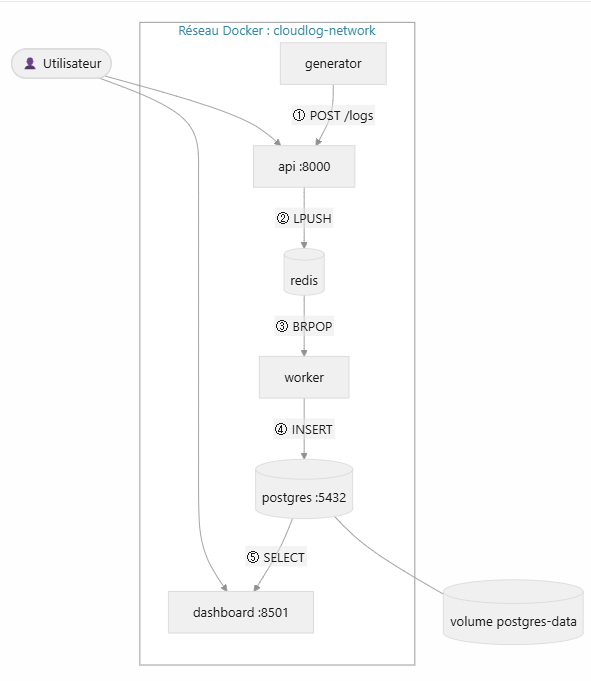

# CloudLog : Plateforme distribuée de surveillance de logs

> Mini-projet **Virtualisation et Cloud Computing**  
> Proposition 2 : Conteneurisation et orchestration locale vs cloud (Docker et Kubernetes)  
> ESSTHS – 3LI

CloudLog est une application distribuée basée sur une architecture microservices. Elle permet de collecter des logs applicatifs, de les mettre en file d'attente, de détecter les anomalies, de les enregistrer dans une base de données et de les visualiser dans un tableau de bord.

Le projet utilise **Docker** pour conteneuriser les composants, **Docker Compose** pour orchestrer les services localement et **Kubernetes avec Minikube** pour leur déploiement et leur gestion.

## Architecture générale

```text
Generator
    |
    v
API FastAPI
    |
    v
Redis (file d'attente)
    |
    v
Worker (traitement et détection)
    |
    v
PostgreSQL (stockage)
    |
    v
Dashboard Streamlit
```

## Table des matières

1. [Présentation du projet](#1-présentation-du-projet)
2. [Grille de notation et correspondance](#2-grille-de-notation-et-correspondance)
3. [Architecture applicative](#3-architecture-applicative)
4. [Stack technique et structure du dépôt](#4-stack-technique-et-structure-du-dépôt)
5. [Conteneurisation avec Docker](#5-conteneurisation-avec-docker)
6. [Orchestration locale avec Docker Compose](#6-orchestration-locale-avec-docker-compose)
7. [Déploiement Kubernetes avec Minikube](#7-déploiement-kubernetes-avec-minikube)
8. [Volumes, données persistantes et réseau](#8-volumes-données-persistantes-et-réseau)
9. [Fonctionnement détaillé des composants](#9-fonctionnement-détaillé-des-composants)
10. [Tests et validation](#10-tests-et-validation)
11. [Reproductibilité](#11-reproductibilité)
12. [Sécurité et bonnes pratiques](#12-sécurité-et-bonnes-pratiques)
13. [Scénario de démonstration](#13-scénario-de-démonstration)
14. [Limites connues et pistes d'amélioration](#14-limites-connues-et-pistes-damélioration)
15. [Dépannage](#15-dépannage)
16. [Équipe](#16-équipe)
17. [Documentation complémentaire](#17-documentation-complémentaire)

---

## 1. Présentation du projet

### 1.1 Contexte

Le mini-projet porte sur la conteneurisation et l'orchestration d'une application composée de plusieurs services.

L'objectif est de passer d'une architecture traditionnelle à une architecture basée sur les conteneurs Docker, puis d'utiliser un orchestrateur pour gérer le déploiement, la communication et la disponibilité des composants.

### 1.2 Problématique

Une application produit continuellement des logs : requêtes, erreurs, temps de réponse et événements système.

L'enregistrement direct de chaque log dans une base de données peut ralentir l'application et créer une dépendance forte entre la réception des événements et leur stockage.

CloudLog résout ce problème en séparant les différentes étapes :

- L'API reçoit et valide rapidement les logs.
- Redis sert de file d'attente temporaire.
- Le Worker consomme les logs et détecte les anomalies.
- PostgreSQL conserve les données.
- Le Dashboard permet de visualiser les résultats.

Cette architecture permet de séparer les responsabilités et de faire évoluer les composants indépendamment.

### 1.3 Objectifs techniques

| Objectif | Réalisation |
|---|---|
| Conteneuriser les composants | Dockerfiles pour API, Worker, Dashboard et Generator |
| Organiser les services localement | Docker Compose |
| Assurer la communication | Réseau Docker et Services Kubernetes |
| Déployer sur un orchestrateur | Kubernetes avec Minikube |
| Gérer les données persistantes | Volume Docker et PVC Kubernetes |
| Gérer les informations sensibles | Variables d'environnement et Secret Kubernetes |
| Vérifier la résilience | Suppression et recréation de Pods |
| Visualiser les données | Dashboard Streamlit |

---

## 2. Grille de notation et correspondance

Le tableau suivant relie les critères du mini-projet aux différentes parties de ce document.

| Critère | Points | Section correspondante |
|---|:---:|---|
| Qualité des Dockerfiles et optimisation des images | 3 | Section 5 |
| Composition et orchestration locale avec Docker Compose | 3 | Section 6 |
| Déploiement sur Kubernetes / Minikube | 5 | Section 7 |
| Gestion des volumes, persistance et réseau | 3 | Section 8 |
| Rapport technique et reproductibilité | 3 | Sections 9, 10 et 11 |
| Démonstration et réponses aux questions | 3 | Section 13 |
| **Total** | **20** | |

---

## 3. Architecture applicative

### 3.1 Vue d'ensemble

CloudLog est composé de six services qui communiquent entre eux.

`

### 3.2 Rôle de chaque service

| Service | Rôle | Port interne | Port publié |
|---|---|:---:|:---:|
| Generator | Génère et envoie les logs | Aucun | Non |
| API | Valide les logs et les place dans Redis | 8000 | 8000 |
| Redis | File d'attente temporaire | 6379 | Non |
| Worker | Analyse et enregistre les logs | Aucun | Non |
| PostgreSQL | Stockage permanent | 5432 | 5432 |
| Dashboard | Affichage des statistiques | 8501 | 8501 |

### 3.3 Cycle de vie d'un log

1. Le Generator crée un événement au format JSON.
2. L'événement contient les informations du log : identifiant, date, application, niveau, message, temps de réponse et code HTTP.
3. L'API reçoit et valide les données.
4. L'API place le log dans Redis.
5. Le Worker récupère les événements depuis Redis.
6. Le Worker applique les règles de détection des anomalies.
7. Les données sont enregistrées dans PostgreSQL.
8. Le Dashboard interroge PostgreSQL et affiche les statistiques.

---

## 4. Stack technique et structure du dépôt

### 4.1 Technologies utilisées

| Technologie | Utilisation |
|---|---|
| Python 3.12 | Développement des services |
| FastAPI | API REST |
| Redis 7 | File d'attente |
| PostgreSQL 16 | Base de données |
| Streamlit | Dashboard |
| Docker | Conteneurisation |
| Docker Compose | Orchestration locale |
| Kubernetes | Orchestration des conteneurs |
| Minikube | Cluster Kubernetes local |
| kubectl | Gestion du cluster |
| Git / GitHub | Gestion du code source |

### 4.2 Structure du dépôt

```text
cloudlog/
│
├── api/
│   ├── Dockerfile
│   ├── main.py
│   ├── requirements.txt
│   ├── .env.example
│   ├── README.md
│   └── tests/
│       ├── __init__.py
│       └── test_api.py
│
├── workers/
│   ├── Dockerfile
│   ├── redis_consumer.py
│   ├── worker.py
│   └── requirements.txt
│
├── generator/
│   ├── Dockerfile
│   ├── generator.py
│   ├── performance_test.py
│   └── requirements.txt
│
├── dashbord/
│   ├── Dockerfile
│   ├── Dockerfile.slim
│   ├── app.py
│   └── requirements.txt
│
├── Database/
│   ├── init.sql
│   ├── fakedata.sql
│   ├── mainreq.sql
│   ├── log_format.json
│   └── READMEdashbord.md
│
├── k8s/
│   ├── namespace.yaml
│   ├── postgres-pvc.yaml
│   ├── postgres-service.yaml
│   ├── postgres-statefulset.yaml
│   ├── redis-deployment.yaml
│   ├── redis-service.yaml
│   ├── api-deployment.yaml
│   ├── worker-deployment.yaml
│   ├── dashboard-deployment.yaml
│   └── generator-job.yaml
│
├── docker-compose.yml
├── .dockerignore
├── .gitignore
└── README.md
```

**Remarque :** le répertoire du Dashboard s'appelle `dashbord` dans le dépôt. Ce nom est conservé dans les commandes et les configurations.

### 4.3 Description des dossiers

- `api/` : contient l'API FastAPI, ses modèles, sa configuration et ses tests.
- `workers/` : contient le consommateur Redis et les règles de traitement des logs.
- `generator/` : contient les scripts de génération et de test de performance.
- `dashbord/` : contient l'interface de visualisation Streamlit.
- `Database/` : contient le schéma SQL, les données fictives et les requêtes.
- `k8s/` : contient les fichiers YAML de déploiement Kubernetes.

---

## 5. Conteneurisation avec Docker

Chaque composant applicatif possède son propre Dockerfile.

### 5.1 Images Docker utilisées

| Service | Image | Dockerfile |
|---|---|---|
| API | `cloudlog-api:dev` | `api/Dockerfile` |
| Worker | `cloudlog-worker:dev` | `workers/Dockerfile` |
| Dashboard | `cloudlog-dashboard:dev` | `dashbord/Dockerfile` |
| Generator | `cloudlog-generator:dev` | `generator/Dockerfile` |

### 5.2 Rôle des Dockerfiles

**API**

Le Dockerfile de l'API :
- Utilise une image Python légère.
- Installe les dépendances FastAPI.
- Copie les fichiers nécessaires.
- Configure le port 8000.
- Lance Uvicorn.

**Worker**

Le Dockerfile du Worker :
- Installe les dépendances nécessaires à Redis et PostgreSQL.
- Copie le code du Worker.
- Permet l'exécution du module Python `workers.redis_consumer`.

Le contexte de construction est la racine du dépôt :

```powershell
docker build -t cloudlog-worker:dev -f workers/Dockerfile .
```

**Dashboard**

Le Dockerfile du Dashboard :
- Installe Streamlit et les dépendances.
- Copie le code de l'application.
- Configure le port 8501.
- Lance Streamlit.

Deux versions sont disponibles :
- `Dockerfile` : version multi-stage.
- `Dockerfile.slim` : version simplifiée pour comparaison.

**Generator**

Le Dockerfile du Generator :
- Installe les dépendances Python.
- Copie les scripts de génération.
- Lance `generator.py`.

### 5.3 Optimisation des images

Les Dockerfiles utilisent notamment les techniques suivantes lorsque configurées :

| Technique | Avantage |
|---|---|
| Image `python:3.12-slim` | Réduction de la taille de l'image de base |
| Build multi-stage | Séparation de la construction et de l'exécution |
| `pip install --no-cache-dir` | Réduction des fichiers temporaires |
| `.dockerignore` | Exclusion des fichiers inutiles |
| Utilisateur non-root | Réduction des privilèges du conteneur |
| Copie sélective | Évite d'intégrer des fichiers inutiles |

### 5.4 Construction des images

Depuis la racine du projet :

```powershell
# API
docker build -t cloudlog-api:dev ./api

# Worker
docker build -t cloudlog-worker:dev -f workers/Dockerfile .

# Dashboard
docker build -t cloudlog-dashboard:dev ./dashbord

# Generator
docker build -t cloudlog-generator:dev ./generator
```

Afficher les images :

```powershell
docker images
```

### 5.5 Comparaison des images du Dashboard

Le projet contient deux Dockerfiles permettant de comparer une version multi-stage et une version simplifiée.


| Version | Description | Taille mesurée (disque) | Taille du contenu |
|---|---|---:|---:|
| Dashboard initial (`cloudlog-dashboard-v0`) | Version de départ | **2,29 Go** | 568 Mo |
| Dashboard slim (`cloudlog-dashboard-v1`) | Image Python slim | **868 Mo** | 200 Mo |
| Dashboard multi-stage (`cloudlog-dashboard-v2`) | Version optimisée | **855 Mo** | 196 Mo |
 
**Gains par rapport à la version initiale**
 
| Version | Gain (disque) | Gain (contenu) |
|---|---:|---:|
| Slim | environ −62 % | environ −65 % |
| Multi-stage | environ −63 % | environ −65 % |

Cette comparaison permet d'observer l'effet du choix de l'image de base et de la construction multi-stage.

---

## 6. Orchestration locale avec Docker Compose

Docker Compose permet de lancer tous les services de l'application avec une seule commande.

### 6.1 Services définis

Le fichier `docker-compose.yml` contient les six services :

- redis
- postgres
- api
- worker
- dashboard
- generator

Il définit également :
- Un réseau `cloudlog-network`.
- Un volume nommé `postgres-data`.
- Les variables d'environnement.
- Les dépendances entre les services.
- Les contrôles de santé.

### 6.2 Communication entre les services

Les services communiquent grâce au réseau Docker Compose.

Par exemple :
- L'API utilise `redis` comme hôte Redis.
- Le Worker utilise `redis` et `postgres`.
- Le Dashboard utilise `postgres`.
- Le Generator utilise `http://api:8000`.

Les noms des services servent de noms DNS à l'intérieur du réseau Docker.

### 6.3 Configuration des variables d'environnement

Docker Compose utilise un fichier `.env` placé à la racine du projet.

Le dépôt contient notamment `api/.env.example` pour documenter la configuration propre à l'API. Pour Docker Compose, il faut créer le fichier `.env` racine en fonction des variables attendues par `docker-compose.yml`.

Exemple de configuration locale :

```env
DB_HOST=postgres
DB_PORT=5432
DB_NAME=cloudlog
DB_USER=clouduser
DB_PASSWORD=YOUR_LOCAL_PASSWORD

REDIS_HOST=redis
REDIS_PORT=6379
REDIS_QUEUE=cloudlog:incoming

API_URL=http://api:8000
WORKER_LOG_EVERY=1000
```

Remplacer `YOUR_LOCAL_PASSWORD` par un mot de passe local.

| Variable | Description |
|---|---|
| `DB_HOST` | Nom du service PostgreSQL |
| `DB_PORT` | Port PostgreSQL |
| `DB_NAME` | Nom de la base |
| `DB_USER` | Utilisateur PostgreSQL |
| `DB_PASSWORD` | Mot de passe PostgreSQL |
| `REDIS_HOST` | Nom du service Redis |
| `REDIS_PORT` | Port Redis |
| `REDIS_QUEUE` | Nom de la file Redis |
| `API_URL` | Adresse de l'API pour le Generator |
| `WORKER_LOG_EVERY` | Fréquence des messages de progression |


### 6.4 Démarrage de l'application

Prérequis :
- Docker Desktop doit être démarré.
- Les ports 5432, 8000 et 8501 doivent être disponibles.
- Le fichier `.env` doit être correctement configuré.

Démarrer les services :

```powershell
docker compose up --build -d
```

Vérifier leur état :

```powershell
docker compose ps
```

Les services principaux attendus sont :

- API
- Redis
- PostgreSQL
- Worker
- Dashboard

Les contrôles de santé permettent de vérifier notamment Redis, PostgreSQL et l'API.

### 6.5 Accès aux interfaces

| Adresse | Description |
|---|---|
| http://localhost:8000/docs | Documentation Swagger de l'API |
| http://localhost:8501 | Dashboard Streamlit |

### 6.6 Génération des logs

Le Generator est configuré avec le profil Compose `tools`. Il n'est donc pas démarré automatiquement avec `docker compose up`.

Pour exécuter le générateur :

```powershell
docker compose --profile tools run --build --rm generator
```

Le Generator envoie son lot de logs puis termine son exécution.

### 6.7 Vérification du Worker

Afficher les derniers messages :

```powershell
docker compose logs worker --tail 50
```

Suivre les messages en direct :

```powershell
docker compose logs -f worker
```

### 6.8 Vérification de Redis

```powershell
docker compose exec redis redis-cli LLEN cloudlog:incoming
```

Cette commande affiche le nombre de logs encore présents dans la file d'attente.

### 6.9 Vérification de PostgreSQL

```powershell
docker compose exec postgres psql -U clouduser -d cloudlog -c "SELECT COUNT(*) FROM logs;"
```

Cette commande affiche le nombre de logs enregistrés.

Pour afficher les derniers événements :

```powershell
docker compose exec postgres psql -U clouduser -d cloudlog -c "SELECT * FROM logs ORDER BY timestamp DESC LIMIT 10;"
```

### 6.10 Arrêt de l'application

| Commande | Effet |
|---|---|
| `docker compose stop` | Arrête les conteneurs |
| `docker compose down` | Supprime les conteneurs et le réseau, conserve le volume |
| `docker compose down -v` | Supprime aussi les volumes et les données persistantes |

**Attention :** `docker compose down -v` entraîne la suppression des données PostgreSQL conservées dans le volume `postgres-data`.

Le fichier `Database/init.sql` est exécuté automatiquement uniquement lors de la première initialisation d'un volume PostgreSQL vide.

---

## 7. Déploiement Kubernetes avec Minikube

Cette partie présente le déploiement de CloudLog dans un cluster Kubernetes local.

### 7.1 Objectifs du déploiement

L'objectif est de :
- Déployer chaque composant dans un Pod.
- Gérer les applications avec des Deployments.
- Utiliser un StatefulSet pour PostgreSQL.
- Gérer le stockage persistant.
- Assurer la communication avec les Services.
- Utiliser un Secret pour les identifiants.
- Vérifier la résilience des Pods.

### 7.2 Correspondance Docker Compose et Kubernetes

| Docker Compose | Kubernetes |
|---|---|
| Réseau Docker | Namespace et DNS du cluster |
| Service PostgreSQL | StatefulSet et Service |
| Service Redis | Deployment et Service |
| Service API | Deployment et Service |
| Service Worker | Deployment |
| Service Dashboard | Deployment et Service |
| Profil Generator | Job |
| Variables sensibles `.env` | Secret Kubernetes |
| Volume PostgreSQL | PersistentVolumeClaim |

### 7.3 Organisation du dossier `k8s/`

```text
k8s/
│
├── namespace.yaml
├── postgres-pvc.yaml
├── postgres-service.yaml
├── postgres-statefulset.yaml
├── redis-deployment.yaml
├── redis-service.yaml
├── api-deployment.yaml
├── worker-deployment.yaml
├── dashboard-deployment.yaml
└── generator-job.yaml
```

### 7.4 Rôle des fichiers Kubernetes

**namespace.yaml**

Crée le namespace `cloudlog`, qui permet de regrouper les ressources du projet.

**postgres-pvc.yaml**

Déclare un PersistentVolumeClaim pour demander un stockage persistant à Kubernetes.

Dans notre configuration, la capacité demandée est de 2 Gi.

**postgres-statefulset.yaml**

Déploie PostgreSQL avec une identité stable et le stockage persistant associé.

**postgres-service.yaml**

Permet aux autres composants d'accéder à PostgreSQL par le réseau interne du cluster.

**redis-deployment.yaml**

Déploie Redis, utilisé comme file d'attente.

**redis-service.yaml**

Permet aux composants d'accéder à Redis par son nom de Service.

**api-deployment.yaml**

Déploie l'API FastAPI et configure ses variables d'environnement, son port et ses contrôles de santé.

**worker-deployment.yaml**

Déploie le Worker chargé de consommer les logs et de les enregistrer dans PostgreSQL.

**dashboard-deployment.yaml**

Déploie l'application Streamlit et expose le Service du Dashboard.

**generator-job.yaml**

Définit un Job Kubernetes qui exécute le générateur de logs puis termine son travail.

### 7.5 Types de ressources utilisés

| Ressource | Composant | Justification |
|---|---|---|
| Namespace | CloudLog | Organisation des ressources |
| Deployment | API | Application sans état local |
| Deployment | Redis | Service de file d'attente |
| Deployment | Worker | Traitement indépendant |
| Deployment | Dashboard | Interface web |
| StatefulSet | PostgreSQL | Base de données avec état |
| PVC | PostgreSQL | Conservation des données |
| Job | Generator | Tâche ponctuelle |
| Service | API, Redis, PostgreSQL, Dashboard | Communication réseau |
| Secret | PostgreSQL | Gestion des identifiants |

### 7.6 Prérequis
### 7.6.1 Installation de kubectl et Minikube (Windows)

Docker Desktop doit être installé et démarré.

```powershell
winget install Kubernetes.kubectl
winget install Kubernetes.minikube
```


Prérequis:
- Docker Desktop.
- Minikube.
- kubectl.
- Les images Docker CloudLog.

Vérifier les outils :

```powershell
docker --version
kubectl version --client
minikube version
```

### 7.7 Démarrage de Minikube

```powershell
minikube start --driver=docker
```

Vérifier le cluster :

```powershell
minikube status
kubectl get nodes
```

### 7.8 Construction et chargement des images

Construire les images :

```powershell
docker build -t cloudlog-api:dev ./api
docker build -t cloudlog-worker:dev -f workers/Dockerfile .
docker build -t cloudlog-dashboard:dev ./dashbord
docker build -t cloudlog-generator:dev ./generator
```

Charger les images dans Minikube :

```powershell
minikube image load cloudlog-api:dev
minikube image load cloudlog-worker:dev
minikube image load cloudlog-dashboard:dev
minikube image load cloudlog-generator:dev
```

Après les quatre commandes, vérifie que le cluster voit bien les images
```powershell
minikube image ls
```
Cette étape est importante : les images construites localement doivent être accessibles au runtime Docker du cluster Minikube.

### 7.9 Création du namespace

```powershell
kubectl apply -f k8s/namespace.yaml
```

Vérifier :

```powershell
kubectl get namespaces
```

Le namespace utilisé est `cloudlog`.

### 7.10 Création du Secret PostgreSQL

Les identifiants PostgreSQL sont stockés dans un Secret Kubernetes nommé `postgres-secret`.

Exemple de création :

```powershell
kubectl create secret generic postgres-secret -n cloudlog `
  --from-literal=POSTGRES_DB=cloudlog `
  --from-literal=POSTGRES_USER=clouduser `
  --from-literal=POSTGRES_PASSWORD=test
```

Remplacer la valeur entre chevrons par le mot de passe choisi localement.

Les clés doivent correspondre exactement aux références présentes dans les manifests.

Vérifier l'existence du Secret :

```powershell
kubectl get secrets -n cloudlog
```

Le Secret ne doit pas être enregistré dans le dépôt Git.

### 7.11 Déploiement de PostgreSQL

Créer le PVC :

```powershell
kubectl apply -f k8s/postgres-pvc.yaml -n cloudlog
```

Créer le Service :

```powershell
kubectl apply -f k8s/postgres-service.yaml -n cloudlog
```

Créer le StatefulSet :

```powershell
kubectl apply -f k8s/postgres-statefulset.yaml -n cloudlog
```

Attendre que PostgreSQL soit prêt :

```powershell
kubectl wait --for=condition=ready pod/postgres-0 -n cloudlog --timeout=120s
```

### 7.12 Initialisation de la base de données

Dans Docker Compose, `Database/init.sql` est monté automatiquement au démarrage initial de PostgreSQL.

Dans Kubernetes, le schéma doit être appliqué séparément si aucun mécanisme d'initialisation automatique n'est configuré.

Commande utilisée :

```powershell
Get-Content Database/init.sql | kubectl exec -i -n cloudlog postgres-0 -- psql -U clouduser -d cloudlog
```

Cette commande transmet le fichier SQL au conteneur PostgreSQL.

### 7.13 Déploiement de Redis

```powershell
kubectl apply -f k8s/redis-deployment.yaml -n cloudlog
kubectl apply -f k8s/redis-service.yaml -n cloudlog
```

Redis est ensuite accessible depuis les autres Pods grâce au Service Kubernetes.

### 7.14 Déploiement de l'API

```powershell
kubectl apply -f k8s/api-deployment.yaml -n cloudlog
```

L'API est déployée avec ses variables d'environnement et ses contrôles de santé.

### 7.15 Déploiement du Worker

```powershell
kubectl apply -f k8s/worker-deployment.yaml -n cloudlog
```

Le Worker se connecte à Redis et PostgreSQL pour traiter les événements.

### 7.16 Déploiement du Dashboard

```powershell
kubectl apply -f k8s/dashboard-deployment.yaml -n cloudlog
```

Le Dashboard est accessible à travers son Service Kubernetes.

### 7.17 Exécution du Generator

```powershell
kubectl apply -f k8s/generator-job.yaml -n cloudlog
```

Le Generator s'exécute une fois et termine son travail.

Son statut peut devenir `Completed`, ce qui est normal pour un Job.

Pour le relancer :

```powershell
kubectl delete job generator -n cloudlog
kubectl apply -f k8s/generator-job.yaml -n cloudlog
```

### 7.18 Vérification du déploiement

Vérifier les Pods :

```powershell
kubectl get pods -n cloudlog
```

Vérifier les Deployments :

```powershell
kubectl get deployments -n cloudlog
```

Vérifier les Services :

```powershell
kubectl get services -n cloudlog
```

Vérifier les StatefulSets :

```powershell
kubectl get statefulsets -n cloudlog
```

Vérifier le stockage :

```powershell
kubectl get pvc -n cloudlog
```

Vérifier les Jobs :

```powershell
kubectl get jobs -n cloudlog
```

### 7.19 Accès au Dashboard

Pour accéder au Dashboard depuis la machine locale :

```powershell
kubectl port-forward -n cloudlog svc/dashboard 8502:8501
```

Ouvrir ensuite :

http://localhost:8502

La commande `port-forward` doit rester active pendant l'utilisation du Dashboard.

### 7.20 Consultation des logs Kubernetes

API :

```powershell
kubectl logs deployment/api -n cloudlog
```

Worker :

```powershell
kubectl logs deployment/worker -n cloudlog
```

Dashboard :

```powershell
kubectl logs deployment/dashboard -n cloudlog
```

PostgreSQL :

```powershell
kubectl logs statefulset/postgres -n cloudlog
```

---

## 8. Volumes, données persistantes et réseau

### 8.1 Persistance des données

La persistance permet de conserver les données même lorsque les conteneurs ou Pods sont recréés.

CloudLog utilise deux mécanismes :

| Environnement | Ressource | Fonction |
|---|---|---|
| Docker Compose | Volume `postgres-data` | Stockage PostgreSQL |
| Kubernetes | PVC `postgres-pvc` | Stockage PostgreSQL |

Dans Kubernetes, le PVC demande une capacité de stockage de 2 Gi avec le mode d'accès `ReadWriteOnce`.

Vérification :

```powershell
kubectl get pvc -n cloudlog
```

Le statut attendu est :

```text
STATUS: Bound
```

### 8.2 Test de persistance PostgreSQL

Supprimer le Pod PostgreSQL :

```powershell
kubectl delete pod postgres-0 -n cloudlog
```

Le StatefulSet recrée automatiquement le Pod.

Après son redémarrage, vérifier les données :

```powershell
kubectl exec -n cloudlog postgres-0 -- psql -U clouduser -d cloudlog -c "SELECT COUNT(*) FROM logs;"
```

Si le volume est correctement configuré, les données doivent être conservées.

### 8.3 Réseau Docker Compose

Docker Compose utilise un réseau de type bridge nommé `cloudlog-network`.

Les services communiquent grâce à leurs noms :

- `api`
- `redis`
- `postgres`
- `dashboard`

### 8.4 Réseau Kubernetes

Kubernetes utilise les Services pour fournir des adresses réseau stables.

Les Services permettent aux composants de communiquer même si les Pods sont supprimés puis recréés.

Vérification :

```powershell
kubectl get services -n cloudlog
kubectl get endpoints -n cloudlog
```

Les Services de type `ClusterIP` sont accessibles à l'intérieur du cluster.

### 8.5 Gestion des secrets

| Environnement | Mécanisme |
|---|---|
| Docker Compose | Fichier `.env` local |
| Kubernetes | Secret `postgres-secret` |

Le mot de passe ne doit jamais être écrit directement dans un fichier YAML versionné.

---

## 9. Fonctionnement détaillé des composants

### 9.1 API FastAPI

L'API est le point d'entrée du système.

Elle permet de :
- Recevoir les logs.
- Valider les événements.
- Les placer dans Redis.
- Vérifier la disponibilité du service.
- Consulter l'état de la file d'attente.

Principaux endpoints :

| Méthode | Endpoint | Fonction |
|---|---|---|
| GET | `/` | Informations sur l'API |
| GET | `/health` | Vérification de santé |
| GET | `/ready` | Vérification de disponibilité |
| POST | `/logs` | Envoi d'un log |
| POST | `/logs/bulk` | Envoi de plusieurs logs |
| GET | `/queue/status` | État de la file Redis |

La documentation interactive est disponible à :

http://localhost:8000/docs

### 9.2 PostgreSQL

PostgreSQL est utilisé pour stocker les logs de façon permanente.

La table principale est `logs`.

Exemple de structure :

```sql
CREATE TABLE IF NOT EXISTS logs (
    id BIGSERIAL PRIMARY KEY,
    event_id UUID NOT NULL UNIQUE,
    timestamp TIMESTAMPTZ NOT NULL,
    application VARCHAR(100) NOT NULL,
    level VARCHAR(10) NOT NULL,
    message TEXT NOT NULL,
    response_time INTEGER NOT NULL,
    status_code INTEGER NOT NULL,
    is_anomaly BOOLEAN NOT NULL DEFAULT FALSE
);

CREATE INDEX IF NOT EXISTS idx_logs_timestamp
ON logs (timestamp);
```

Le champ `event_id` permet d'identifier chaque événement de façon unique.

### 9.3 Worker

Le Worker est chargé de consommer les logs depuis Redis et de les enregistrer dans PostgreSQL.

Son fonctionnement :

1. Connexion à Redis.
2. Connexion à PostgreSQL.
3. Lecture des logs dans la file d'attente.
4. Analyse des événements.
5. Détection des anomalies.
6. Insertion dans la base de données.

### 9.4 Détection des anomalies

Les règles de détection peuvent notamment considérer :

| Règle | Condition |
|---|---|
| Temps de réponse élevé | Temps de réponse supérieur au seuil configuré |
| Erreur serveur | Code HTTP supérieur ou égal à 500 |
| Niveau critique | Niveau `ERROR` |

Le résultat de l'analyse est stocké dans le champ `is_anomaly`.

### 9.5 Dashboard Streamlit

Le Dashboard permet de visualiser les logs stockés dans PostgreSQL.

Il affiche notamment :
- Le nombre total de logs.
- Le nombre d'erreurs.
- Le nombre d'anomalies.
- Le temps de réponse moyen.
- Des graphiques et des statistiques.
- Les dernières anomalies.

Il permet également de filtrer les résultats selon les critères disponibles dans l'interface.

### 9.6 Generator

Le Generator crée des événements fictifs pour tester l'application.

Il permet de vérifier le fonctionnement de toute la chaîne :

```text
Generator → API → Redis → Worker → PostgreSQL → Dashboard
```

Le script `generator.py` est utilisé pour la génération normale des logs.

Le script `performance_test.py` est prévu pour les tests de performance.

### 9.7 Base de données de test

Le dossier `Database/` contient plusieurs fichiers :

| Fichier | Rôle |
|---|---|
| `init.sql` | Création de la table principale |
| `fakedata.sql` | Insertion de données fictives |
| `mainreq.sql` | Requêtes SQL utilisées pour les statistiques |
| `log_format.json` | Exemple de format de log |
| `READMEdashbord.md` | Documentation du développement du Dashboard |

---

## 10. Tests et validation

Les tests ont pour objectif de vérifier que les différents composants fonctionnent correctement et communiquent entre eux.

### 10.1 Tests automatisés de l'API

Installation des dépendances :

```powershell
pip install -r api/requirements.txt
```

Exécution des tests :

```powershell
python -m pytest api/tests -q
```

Les tests de l'API permettent de vérifier les endpoints et la validation des données.

Le résultat exact doit être indiqué après exécution de la commande.

### 10.2 Vérification de Docker Compose

```powershell
docker compose ps
```

Cette commande permet de vérifier l'état des services.

### 10.3 Vérification de l'API

Ouvrir :

http://localhost:8000/docs

Tester notamment les endpoints `/health` et `/ready`.

### 10.4 Vérification de la génération

```powershell
docker compose --profile tools run --build --rm generator
```

Le Generator envoie les événements à l'API.

### 10.5 Vérification du Worker

```powershell
docker compose logs worker --tail 50
```

Les logs permettent de vérifier :
- La connexion à Redis.
- La connexion à PostgreSQL.
- Le traitement des événements.
- Le nombre de logs enregistrés.

### 10.6 Vérification de PostgreSQL

```powershell
docker compose exec postgres psql -U clouduser -d cloudlog -c "SELECT COUNT(*) FROM logs;"
```

Cette requête retourne le nombre total d'enregistrements.

### 10.7 Test de résilience de l'API Kubernetes

Supprimer le Pod API :

```powershell
kubectl delete pod -n cloudlog -l app=api
```

Vérifier sa recréation :

```powershell
kubectl get pods -n cloudlog
```

Le Deployment doit créer un nouveau Pod pour maintenir le nombre de réplicas demandé.

### 10.8 Test de persistance PostgreSQL

Supprimer le Pod :

```powershell
kubectl delete pod postgres-0 -n cloudlog
```

Attendre sa recréation :

```powershell
kubectl get pods -n cloudlog
```

Vérifier ensuite les données :

```powershell
kubectl exec -n cloudlog postgres-0 -- psql -U clouduser -d cloudlog -c "SELECT COUNT(*) FROM logs;"
```

Les données doivent rester présentes grâce au PVC.

### 10.9 Résultats observés

Lors des tests communiqués pour le déploiement Kubernetes, les résultats suivants ont été observés :

| Vérification | Résultat |
|---|---|
| Logs traités | 1000 |
| Logs enregistrés | 1000 |
| Doublons | 0 |
| Logs rejetés | 0 |
| Anomalies identifiées | 812 |
| Persistance PostgreSQL | Données conservées après recréation du Pod |
| API | Endpoints de santé vérifiés |
| Dashboard | Accessible depuis le navigateur |

Ces résultats correspondent aux tests réalisés et rapportés pour l'environnement Kubernetes. Ils ne constituent pas une garantie que chaque nouvelle exécution produira exactement les mêmes valeurs.

---

## 11. Reproductibilité

Cette section explique comment récupérer et exécuter le projet depuis une nouvelle machine.

### 11.1 Prérequis

| Outil | Utilisation |
|---|---|
| Git | Récupération du dépôt |
| Docker Desktop | Construction et exécution des conteneurs |
| Docker Compose v2 | Orchestration locale |
| Minikube | Cluster Kubernetes local |
| kubectl | Gestion du cluster |
| Python 3.12 | Tests ou exécution hors Docker |

### 11.2 Récupération du projet

```powershell
git clone https://github.com/tesnim44/cloudlog.git
cd cloudlog
```

Pour récupérer la branche DevOps :

```powershell
git checkout devops-kubernetes
```

### 11.3 Configuration locale

Créer le fichier `.env` à la racine avec les variables décrites dans la section 6.3.


### 11.4 Démarrage avec Docker Compose

```powershell
docker compose up --build -d
```

Vérifier les services :

```powershell
docker compose ps
```

### 11.5 Génération des logs

```powershell
docker compose --profile tools run --build --rm generator
```

### 11.6 Accès au Dashboard

Ouvrir :

http://localhost:8501

### 11.7 Déploiement Kubernetes

Pour reproduire le déploiement Kubernetes, suivre les étapes détaillées de la section 7 :

1. Démarrer Minikube.
2. Construire les images.
3. Charger les images dans Minikube.
4. Créer le namespace.
5. Créer le Secret PostgreSQL.
6. Déployer PostgreSQL et Redis.
7. Initialiser la base.
8. Déployer API, Worker et Dashboard.
9. Exécuter le Generator.
10. Vérifier les Pods et les Services.

---

## 12. Sécurité et bonnes pratiques

| Bonne pratique | Mise en œuvre |
|---|---|
| Protection des identifiants | Fichier `.env` local et Secret Kubernetes |
| Exclusion des secrets | `.gitignore` et `.dockerignore` |
| Communication interne | Réseau Docker et Services Kubernetes |
| Validation des entrées | API FastAPI |
| Séparation des responsabilités | API, Worker, Redis et PostgreSQL |
| Stockage persistant | Volume Docker et PVC Kubernetes |
| Contrôles de santé | Healthchecks et probes |
| Limitation des ports exposés | Redis et Worker non publiés |

### 12.1 Protection des informations sensibles

Ne jamais versionner :
- Le fichier `.env`.
- Les mots de passe.
- Les identifiants de connexion.
- Les fichiers contenant les valeurs des Secrets Kubernetes.

### 12.2 Secret Kubernetes

Les Secrets Kubernetes permettent de séparer les identifiants des manifests de déploiement.

Attention : les valeurs d'un Secret Kubernetes sont encodées en Base64 par défaut. Cela ne signifie pas qu'elles sont automatiquement chiffrées.

Il faut donc protéger les accès au cluster.

---

## 13. Scénario de démonstration

Voici un scénario conseillé pour présenter le projet.

| Étape | Action | Résultat attendu |
|---|---|---|
| 1 | Présenter l'architecture | Expliquer le rôle de chaque service |
| 2 | Construire les images Docker | Afficher les images disponibles |
| 3 | Lancer Docker Compose | Démarrer les services |
| 4 | Exécuter le Generator | Envoyer les logs |
| 5 | Consulter les logs du Worker | Montrer le traitement |
| 6 | Interroger PostgreSQL | Vérifier les enregistrements |
| 7 | Ouvrir le Dashboard | Montrer les statistiques |
| 8 | Démarrer Minikube | Présenter le cluster |
| 9 | Déployer les manifests | Afficher les Pods et Services |
| 10 | Supprimer le Pod API | Montrer sa recréation automatique |
| 11 | Supprimer le Pod PostgreSQL | Vérifier la persistance des données |

### Commandes principales pour la démonstration

```powershell
# Docker Compose
docker compose up --build -d

# Génération
docker compose --profile tools run --build --rm generator

# Vérification
docker compose ps
docker compose logs worker

# Kubernetes
minikube start --driver=docker
kubectl get nodes
kubectl get pods -n cloudlog
kubectl get services -n cloudlog
kubectl get pvc -n cloudlog
```

---

## 14. Limites connues et pistes d'amélioration

Le projet constitue une première version fonctionnelle d'une architecture distribuée. Plusieurs améliorations peuvent être envisagées.

| Limite | Conséquence | Amélioration possible |
|---|---|---|
| Redis sans stockage persistant configuré dans Kubernetes | Les données de la file peuvent être perdues lors de la recréation de Redis | Ajouter un volume persistant |
| Traitement asynchrone simple | Un arrêt brutal du Worker peut entraîner une perte d'événement retiré de la file avant son insertion | Utiliser Redis Streams et des accusés de réception |
| Une seule instance PostgreSQL | Pas de haute disponibilité de la base | Ajouter une stratégie de réplication |
| Dépendances Python non épinglées | Les builds peuvent différer selon la date | Ajouter un fichier de verrouillage |
| Pas de limites de ressources Kubernetes | Les ressources peuvent être consommées sans limites explicites | Définir requests et limits |
| Peu de sondes sur certains composants | Certains blocages peuvent ne pas être détectés | Ajouter des probes adaptées |
| Services Kubernetes internes | Accès externe par port-forward | Ajouter un Ingress |
| Pas d'authentification utilisateur | Accès non protégé au prototype | Ajouter une authentification |

---

## 15. Dépannage


Commandes de diagnostic :

```powershell
# Docker Compose
docker compose ps
docker compose logs

# Kubernetes
kubectl get pods -n cloudlog
kubectl describe pod <nom-du-pod> -n cloudlog
kubectl logs <nom-du-pod> -n cloudlog
kubectl get events -n cloudlog
kubectl get pvc -n cloudlog
```

---

## 16. Équipe

| Membre | Partie | Responsabilités |
|---|---|---|
| Emna | Étudiant C | Développement du Dashboard avec Streamlit, préparation de la base de test et des données fictives, configuration de Docker Compose et création du Dockerfile du Dashboard. |
| Rahma | Étudiant A | Développement du backend avec FastAPI, création et validation des endpoints et du format des logs, intégration de Redis, gestion des erreurs, création du Dockerfile de l’API et tests des endpoints. |
| Eya | Étudiant B | Développement du générateur de logs fictifs et des Workers en Python, intégration de la file d’attente Redis, détection des anomalies et réalisation de tests fonctionnels et de performance jusqu’à 100 000 logs. |
| Tesnim | Étudiant D | Déploiement de l’application sur Kubernetes avec Minikube, création des manifests YAML et configuration du Namespace, Deployments, StatefulSet, Services, PVC, Secret et Job, ainsi que des tests de résilience. |

### Partie DevOps 

La partie DevOps comprend notamment :

- Préparation de l'environnement Docker Desktop et Minikube.
- Construction et chargement des images Docker dans Minikube.
- Création du namespace `cloudlog`.
- Configuration du Secret PostgreSQL.
- Déploiement des composants avec les manifests Kubernetes.
- Configuration des Services pour la communication interne.
- Mise en place du stockage persistant PostgreSQL avec un PVC.
- Exécution du Generator avec un Job Kubernetes.
- Vérification des Pods, Services et volumes.
- Tests de recréation des Pods et de persistance des données.
- Accès au Dashboard avec `kubectl port-forward`.

---

## 17. Documentation complémentaire

| Document | Description |
|---|---|
| [API README](api/README.md) | Documentation de l'API FastAPI |
| [Dashboard README](Database/READMEdashbord.md) | Développement du Dashboard et de la base de test |
| [Requêtes SQL](Database/mainreq.sql) | Requêtes utilisées pour les statistiques |
| [Format des logs](Database/log_format.json) | Exemple de structure d'un événement |
| [Docker Compose](docker-compose.yml) | Configuration de l'orchestration locale |
| [Kubernetes](k8s/) | Manifests de déploiement |

---

## Conclusion

CloudLog est une application distribuée qui permet de collecter, traiter, stocker et visualiser des logs applicatifs.

Ce projet met en pratique plusieurs concepts importants de la virtualisation et du Cloud Computing :

- La conteneurisation avec Docker.
- L'orchestration locale avec Docker Compose.
- Le déploiement avec Kubernetes et Minikube.
- La communication entre microservices.
- Le traitement asynchrone avec Redis.
- Le stockage relationnel avec PostgreSQL.
- La persistance des données avec les volumes et PVC.
- La gestion des informations sensibles avec les Secrets.
- La résilience et la recréation automatique des Pods.

Le projet permet ainsi de comprendre comment construire et déployer une application distribuée composée de plusieurs services indépendants.


